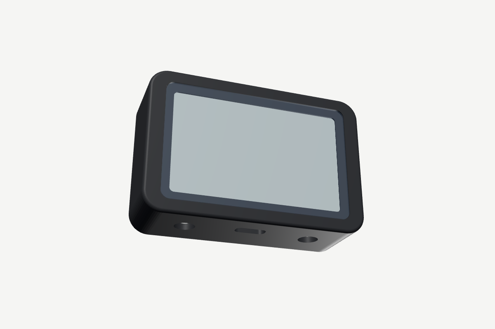
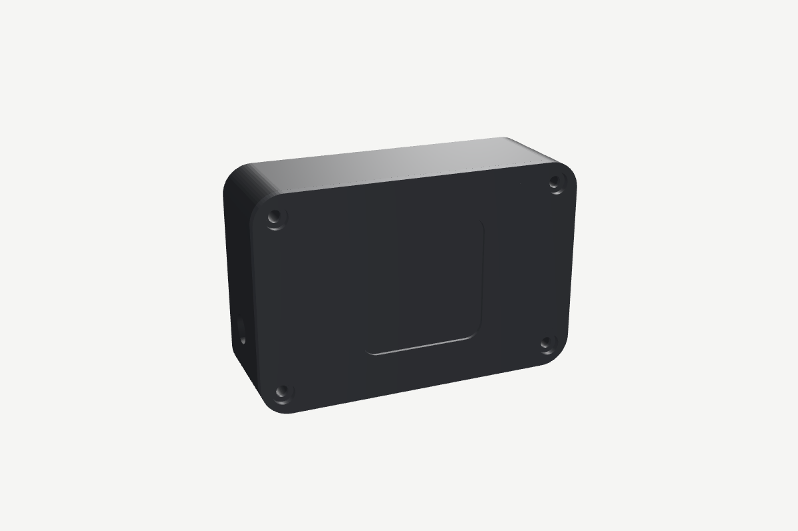
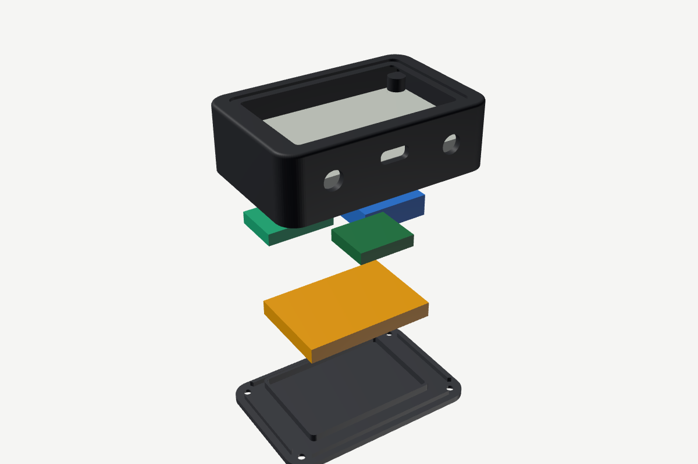
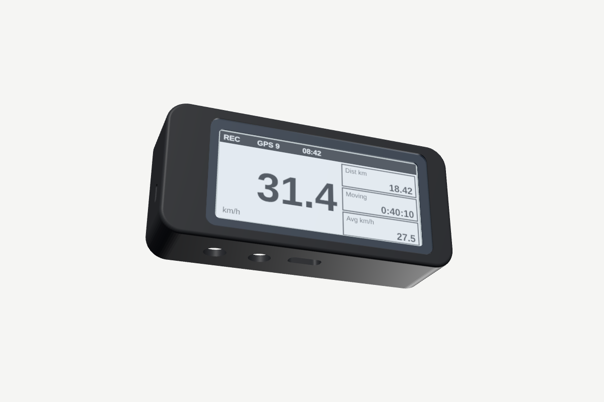
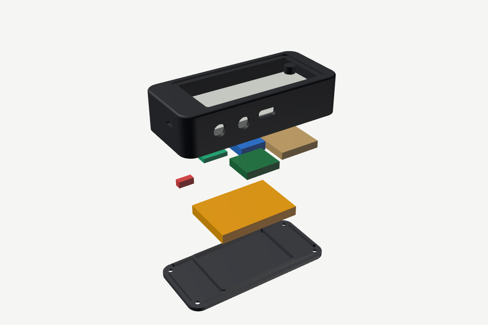

# Ride Log bike computer: hardware

A small GPS bike computer you can build yourself, with a screen you can read in sunlight, GPS, a barometer for climbing, and three buttons. It connects to heart-rate and power sensors over Bluetooth, which also works with iPhones, because the device does the Bluetooth itself.

| Front | Back | Exploded |
|---|---|---|
|  |  |  |

## Two versions
| | **v1: AliExpress (build this first)** | Adafruit (later) |
|---|---|---|
| Screen | Waveshare 2.9" e-paper, 296×128 | Sharp 2.7" memory LCD, 400×240 |
| GPS / barometer | ATGM336H / BMP280 | PA1010D / BMP390 |
| Case | 94.7 × 43.2 × 25 mm | 77.2 × 51.2 × 27.5 mm |
| Files | `out/v1_epaper/` | `out/adafruit_sharp/` |
| Parts | **~$70** | ~$196 |
| Firmware setting (`config.h`) | `HW_V1_ALIEXPRESS` | `HW_ADAFRUIT` |

Shopping list with links for both versions: [`shopping-list.html`](shopping-list.html) (open it in a browser).

**Try it before you buy anything:** [`simulator/index.html`](simulator/index.html) runs the v1 firmware's logic and screens in your browser. Ride a route, press the buttons, connect sensors, save the ride and import it into Ride Log.

| v1 front | v1 exploded |
|---|---|
|  |  |

### v1 wiring

```
XIAO ESP32-S3   Part
─────────────   ──────────────────────────────────────────────
3V3  ─────────  e-paper VCC · e-paper RST · GPS VCC · BMP280 VCC · BMP280 CSB
GND  ─────────  e-paper GND · GPS GND · BMP280 GND · BMP280 SDO · all 3 buttons
D8   ─────────  e-paper CLK
D10  ─────────  e-paper DIN
D3   ─────────  e-paper CS
D6   ─────────  e-paper DC
D9   ─────────  e-paper BUSY
D4 (SDA) ─────  BMP280 SDA
D5 (SCL) ─────  BMP280 SCL
D7   ─────────  GPS TX            (GPS RX not connected)
D0   ─────────  Button "Lap"          (other leg to GND)
D1   ─────────  Button "Start/Pause"  (other leg to GND)
D2   ─────────  Button "Page"         (other leg to GND)
Battery red ──  slide switch (middle pin) ── outer pin ── XIAO BAT+ pad
Battery black ─ XIAO BAT- pad
```
- **v1 trade-offs.** The XIAO runs out of pins, so v1 doesn't show battery %, and it uses a slide switch for power instead of sleep mode. The battery only charges while the switch is **on**.
- **BMP280 address.** With SDO on GND and CSB on 3V3 the BMP280 talks I²C at address 0x76. If the Device screen says "Baro missing", change `BARO_I2C_ADDR` to 0x77.
- **Screen refresh.** The e-paper updates once a second while you ride. About every 3 minutes it does a full refresh, flashing black for a moment to clear faint "ghosts" of old numbers. Hold **PAGE** to do one any time.
- **Measure before printing.** The e-paper module's board (89.5 × 38 mm) is from Waveshare's datasheet. The screen's offset on the board (`ACTIVE_OFFSET`, assumed 3 mm towards the plug end) and the BMP280 board size are **assumptions**. Measure yours, then re-run `bike_computer.py v1_epaper`.

---

# Adafruit version (later)

## Building the prototype: order of steps
1. **Order the parts** (list below).
2. **Breadboard first:** wire everything on a breadboard (see Wiring), install the firmware ([`firmware/README.md`](firmware/README.md)), and check the screen, GPS, buttons and sensors work before soldering anything.
3. **Measure the display board** with calipers. If it isn't 72 × 46 mm, update `bike_computer.py`, or send the measurements and the case will be resized.
4. **Print the case** in PETG or ASA, on your own printer or through an online service (JLC3DP, Craftcloud, a local makerspace).
5. **Solder and assemble** (steps at the bottom), then go for a ride and import it into the app.

## Files
| File | What it is |
|---|---|
| `bike_computer.py` | The parametric CAD model ([CadQuery](https://cadquery.readthedocs.io)). All the sizes are at the top. |
| `out/<version>/front_shell.step`, `out/<version>/back_cover.step` | Printed parts. **These open in SolidWorks**, Fusion 360, Onshape, FreeCAD and Shapr3D. |
| `out/<version>/assembly.step` | The whole device, with stand-in blocks for the bought parts so you can check the fit. |
| `out/<version>/front_shell.stl`, `out/<version>/back_cover.stl` | Ready to slice and 3D print. |

To rebuild the files after changing a size:

```bash
pip install cadquery
```

```bash
python bike_computer.py            # both versions; or add v1_epaper / adafruit_sharp
```

## Parts to buy (about $130–$150 total)
Prices are approximate (USD, late 2026) and vary by shop.

| # | Part | Why this one | Approx. |
|---|---|---|---|
| 1 | **Seeed Studio XIAO ESP32-S3** | The brain. Tiny (21 × 17.5 mm), with Bluetooth for heart-rate and power sensors, Wi-Fi to upload rides, USB-C, and a **built-in battery charger**. | $8 |
| 2 | **Adafruit SHARP Memory Display Breakout, 2.7" 400×240** (Adafruit 4694) | Reflective screen that's easy to read in direct sun and uses almost no power. It's the same kind of screen idea that real bike computers use. | $45 |
| 3 | **Adafruit Mini GPS PA1010D** (Adafruit 4415, STEMMA QT) | Small GPS with a built-in antenna (25.5 × 25.4 × 8.2 mm). Uses I²C, so only 2 data wires. | $30 |
| 4 | **Adafruit BMP390 barometer** (STEMMA QT) | Air pressure, for much more accurate climbing than GPS altitude. Shares the I²C wires with the GPS. | $11 |
| 5 | **LiPo battery 603450, 3.7 V ~1200 mAh**, with JST-PH lead and protection circuit | Fits the cradle (50 × 34 × 6 mm). About 10–15 h of riding (estimate). | $10 |
| 6 | **3 × 7 mm panel-mount momentary push buttons** (normally open, e.g. PBS-110 style) | Lap, Start/Pause, and Page/Power. | $5 |
| 7 | **4 × M2.5 heat-set inserts** (OD ~3.6 mm, 4 mm long) + **4 × M2.5 × 6 mm screws** | Hold the back on. | $8 (kit) |
| 8 | **1 mm clear acrylic or polycarbonate sheet** | Screen window, cut to 65.8 × 42.3 mm (sanded corners, R3). | $6 |
| 9 | **Garmin quarter-turn mount adapter**, stick-on (3M adhesive) | Fits the recess on the back, so it clips into any Garmin bar mount. | $8 |
| 10 | **2 × STEMMA QT / Qwiic cables** (one with loose ends or a male header) | Daisy-chains the GPS and barometer to the XIAO. | $3 |
| 11 | Hook-up wire (28–30 AWG silicone), 2 × 220 kΩ resistors, foam tape, Kapton tape | Wiring, battery-voltage sensing, padding. | $8 |
| 12 | 3D-printing filament: **PETG or ASA** (not PLA, which softens in a hot car) | The case. | ~$1 of filament |

**Tools:** soldering iron (also used to press in the inserts), a 3D printer or a print service, small screwdrivers, flush cutters, and a multimeter is handy.

> **Measure before you print.** I couldn't confirm the full board size of the Adafruit display, only its viewable area (58.8 × 35.3 mm). The model assumes a **72 × 46 mm** board, 4 mm thick with parts, and the screen centred on it. Check yours with calipers. If it differs, change `DISP_PCB_W`, `DISP_PCB_H`, `DISP_STACK` and the `ACTIVE_OFFSET` values at the top of `bike_computer.py`, then re-run. The same applies to anything marked **ASSUMED**.

## Wiring

```
XIAO ESP32-S3          Part
─────────────          ─────────────────────────────────────────
3V3  ────────────────  Display VIN · GPS VIN · Barometer VIN
GND  ────────────────  Display GND · GPS GND · Barometer GND · all 3 buttons
D8 (SCK)  ───────────  Display CLK
D10 (MOSI) ──────────  Display DI
D3   ────────────────  Display CS
D4 (SDA) ────────────  GPS SDA ── Barometer SDA   (STEMMA QT chain)
D5 (SCL) ────────────  GPS SCL ── Barometer SCL
D0   ────────────────  Button "Lap"          (other leg to GND)
D1   ────────────────  Button "Start/Pause"  (other leg to GND)
D2   ────────────────  Button "Page/Power"   (other leg to GND)
D9 (A9) ─────────────  middle of 220k/220k divider between BAT+ and GND (battery %)
BAT+ / BAT- pads ────  LiPo red / black   (pads on the underside of the XIAO)
```
- Buttons use the ESP32's internal pull-ups, so no resistors are needed.
- The GPS (I²C address 0x10) and barometer (0x77) share the bus.
- Press and hold **Page/Power** to put the ESP32 into deep sleep (about 14 µA), and send the GPS its standby command. There's no separate power switch.
- **Double-check the battery's red/black wires against the XIAO pads before connecting.** Reversed LiPo leads are the most common way to destroy a board.

## Printing
- **Material:** PETG or ASA, 0.2 mm layers, 4 walls, 25% infill.
- **Front shell:** print **screen-side down**, so the face comes out flat and clean. No supports, except a little under the side button holes, which "supports touching build plate only" handles.
- **Back cover:** the STL is already flipped, so the outside face sits on the bed.
- Press the M2.5 heat-set inserts into the four corner posts with the soldering iron at about 220 °C.

## Assembly
1. Glue the clear window into the recess on the front, with a thin bead of clear silicone or UV glue at the edges, not over the screen.
2. Lay the display board screen-down into the shell, then add a strip of foam tape on its back.
3. Fit the buttons through the holes and tighten their nuts.
4. Solder the wiring above. Then stick the GPS (antenna side **towards the front**, so it faces the sky when mounted), the barometer and the XIAO onto the foam with the XIAO's USB-C lined up with the bottom slot.
5. Put the battery in the cradle on the back cover, wrapped in Kapton tape.
6. Screw the back on. Stick the Garmin adapter into the square recess.

## Software
**Done:** see [`firmware/`](firmware/). It covers the ride screens, GPS, barometer, buttons, Bluetooth heart-rate, power and cadence, saving rides, and Wi-Fi transfer of rides to your phone for import into the app.
The original plan, for reference:
- **Display and controls:** draw the same ride screen as the app (speed, distance, time, laps, zones) on the Sharp display, and use the three buttons for Lap, Start/Pause and Page.
- **Sensors:** read the GPS and barometer, and connect to heart-rate and power sensors over Bluetooth with the NimBLE library.
- **Storage and upload:** save rides to the XIAO's 8 MB flash. Back home, upload them over Wi-Fi straight into your **Ride Log account** (the same Supabase database the app uses), so they appear in the app automatically.
